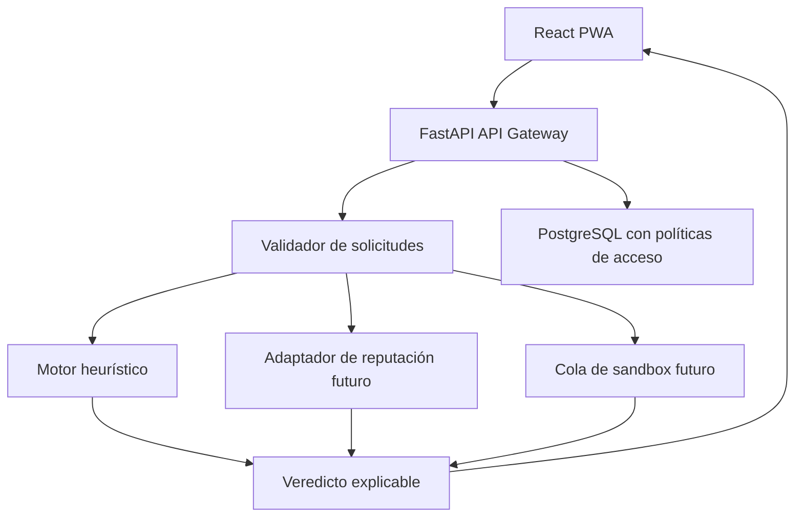

# Arquitectura profesional

## Separación por capas
1. React/PWA: selección de módulo, cámara QR e informe. Nunca redirige al contenido inspeccionado.
2. FastAPI: validación, control de límites, orquestación y API versionada.
3. Motor estático: reglas deterministas con códigos de hallazgos trazables y versión del motor.
4. Reputación (futuro): adaptadores independientes (Web Risk u otros con licencias comerciales), con timeouts, caché y respeto a privacidad.
5. Cola (futuro): Redis + workers para cargas intensivas.
6. Sandbox (futuro): workers efímeros en VM/infraestructura especializada, sin credenciales, sin acceso a VPC interna, con egreso controlado y registro.
7. PostgreSQL: metadatos consentidos, mínimo privilegio, retención corta y auditoría.

## Evolución
Monorepo: `frontend/`, `backend/app/`, `backend/tests/`, `database/`, `docs/`. En producción separar adaptadores de inteligencia (`ports` y `adapters`), dominio de detección, orquestación de jobs y gateways de persistencia.

## Capacidad / escalado
Procesos API stateless, rate limiting externo, caché por hash salado y tipo, cola de tareas y trabajos idempotentes; no almacenar URLs con tokens en logs. Distinguir seguridad de la plataforma de precisión predictiva.
